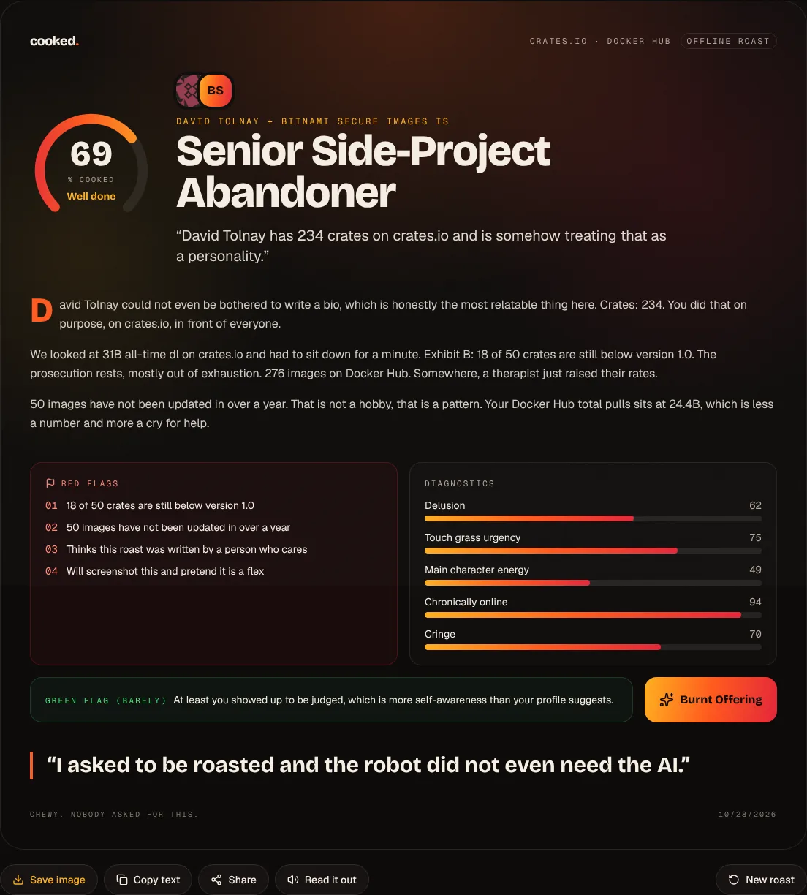
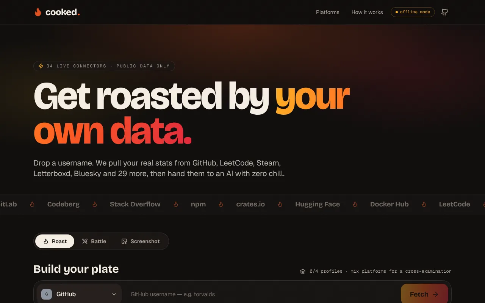
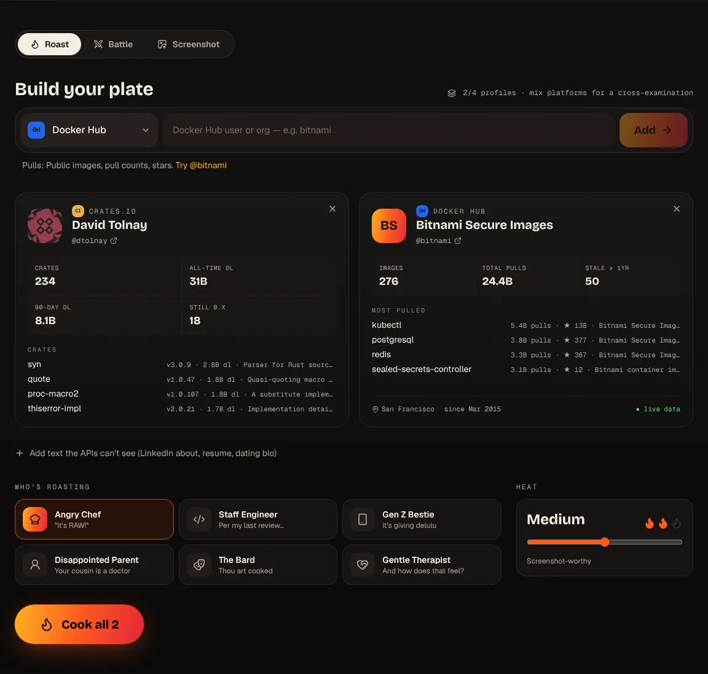
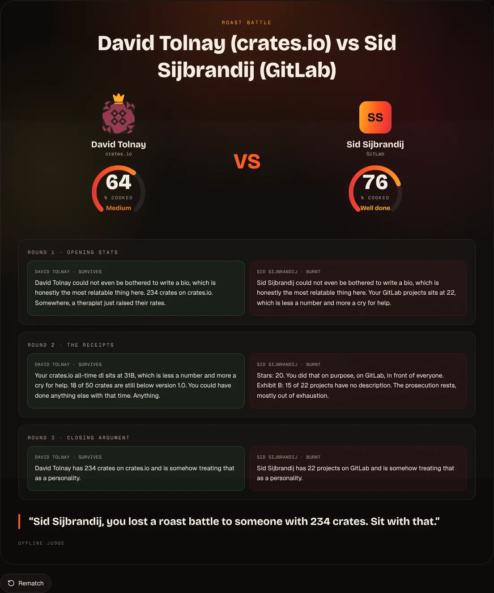
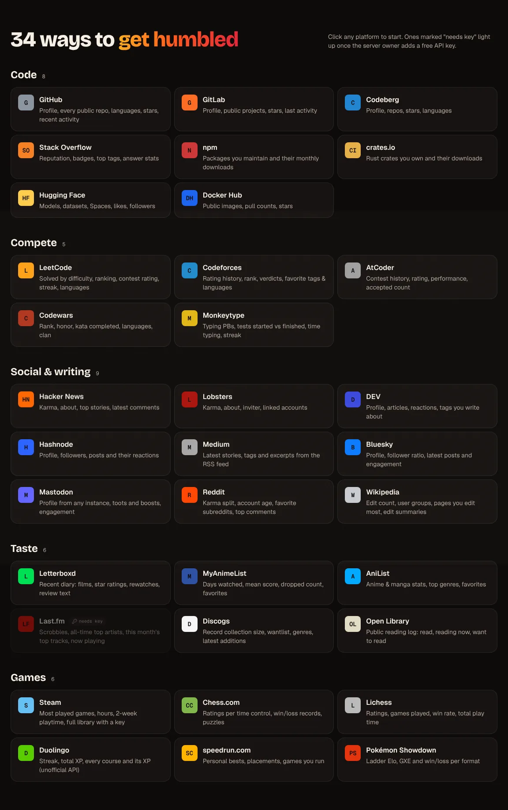
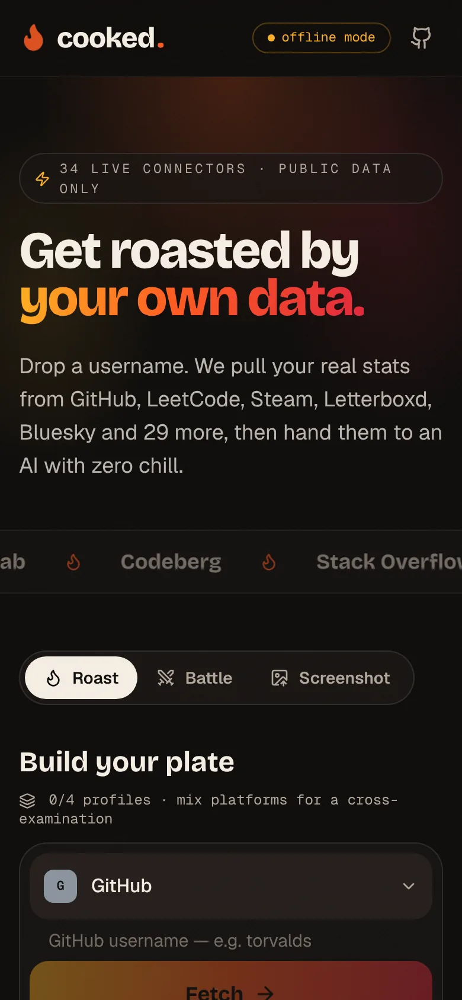

# cooked. — get roasted by your own data

Type a username from one of 34 platforms. Cooked pulls your real public stats and an AI turns them into a roast card you can share.

**[Try it live →](https://cooked-the-profile-roaster.vercel.app)**

[](https://vercel.com/new/clone?repository-url=https%3A%2F%2Fgithub.com%2Ftheflighttechofficial%2FCooked-the-profile-roaster&env=GEMINI_API_KEY&envDescription=Gemini%20API%20key%20for%20AI-written%20roasts&envLink=https%3A%2F%2Faistudio.google.com%2Fapikey)
[](LICENSE)



## Quick start

1. `git clone https://github.com/theflighttechofficial/Cooked-the-profile-roaster && cd Cooked-the-profile-roaster && npm install`
2. `cp .env.example .env` and set `GEMINI_API_KEY` ([free key](https://aistudio.google.com/apikey)). Skip it and the built-in local roaster writes the roasts.
3. `npm run dev`, then open http://localhost:3000.

Or with Docker:

```bash
docker build -t cooked .
docker run -p 3000:3000 -e GEMINI_API_KEY=your-key cooked
```

## What it does

- **Roast**: stack up to 4 profiles from different platforms into one roast. You can also paste text the APIs can't reach, like a LinkedIn "about" section or a resume.
- **Battle**: two profiles go three rounds, and the AI picks who is less cooked.
- **Screenshot**: upload a screenshot (Spotify Wrapped, a bio, Screen Time) and Gemini reads it.
- 6 roaster personas × 3 heat levels. Save the card as a PNG, copy it, share it, or have your browser read it out loud.
- A roast always comes back. If the AI is down or not set up, a local engine takes over (see [When the AI is unavailable](#when-the-ai-is-unavailable)).

## Screenshots

The profiles below are real crates.io, Docker Hub and GitLab data. The roast text comes from the local roaster; with `GEMINI_API_KEY` set, Gemini writes it instead.

| Home | Build your plate |
|---|---|
|  |  |
| **Roast battle** | **All 34 platforms** |
|  |  |

<p align="center"></p>

## When the AI is unavailable

Every roast goes down this chain and stops at the first step that works:

| Step | Engine | Runs where | Needs |
|---|---|---|---|
| 1 | Gemini (`gemini-3.5-flash-lite` by default) | Google | `GEMINI_API_KEY` |
| 2 | Groq, text only (`llama-3.1-8b-instant` by default) | Groq | `GROQ_API_KEY` |
| 3 | Ollama, any local model (`llama3.2` by default) | your machine or Docker host | `OLLAMA_URL` |
| 4 | Built-in local roaster | inside the Cooked server | nothing |

A missing key, a rejected key, an overloaded model, a timeout or a malformed answer all count as "did not work", so the next step runs. The card shows which engine wrote it: "AI roast", "AI roast (Groq)", "local AI roast" or "local roast". Groq's free tier has per-minute and per-day limits; when they are hit, Groq answers 429 and the roast moves on to the next step.

The built-in roaster reads the same profile data the AI gets. It turns stats into signals (clout, output, time sunk, skill, unfinished things) and writes in the persona you picked (chef, staff engineer, Gen Z, parent, bard, therapist) at the heat you picked. It handles single roasts, multi-profile roasts, battles and pasted text.

**Screenshots.** Only Gemini reads images. Without it, or when it fails, your browser reads the text with on-device OCR ([tesseract.js](https://github.com/naptha/tesseract.js), served from this site, no CDN), and the text is roasted instead. The image itself is never uploaded in that case.

**Ollama setup:**

```bash
ollama pull llama3.2
OLLAMA_URL=http://localhost:11434 npm run dev
```

Ollama only helps where the Cooked server can reach it: your own machine or a Docker host. On Vercel, steps 1, 2 and 4 apply.

## Connectors

Each connector uses an official public API or a public feed. None needs a login, and none scrapes pages that sit behind a login.

| Category | Platform | Source |
|---|---|---|
| Code | GitHub | REST API v3 (`GITHUB_TOKEN` optional) |
| | GitLab | REST API v4 |
| | Codeberg | Forgejo API v1 |
| | Stack Overflow | Stack Exchange API 2.3 |
| | npm | Registry search + downloads API |
| | crates.io | crates.io API v1 |
| | Hugging Face | Hub API |
| | Docker Hub | Hub API v2 |
| Compete | LeetCode | Public GraphQL |
| | Codeforces | Official API |
| | AtCoder | Contest history JSON + kenkoooo API |
| | Codewars | API v1 |
| | Monkeytype | Public profile API |
| Social | Hacker News | Firebase API + Algolia search |
| | Lobsters | User JSON |
| | DEV | Forem API |
| | Hashnode | GraphQL API |
| | Medium | RSS feed |
| | Bluesky | AppView XRPC (public) |
| | Mastodon | Any instance, REST API |
| | Reddit | OAuth API (`REDDIT_CLIENT_ID/SECRET` recommended) |
| | Wikipedia | MediaWiki Action API |
| Taste | Letterboxd | RSS feed |
| | MyAnimeList | Jikan API v4 |
| | AniList | GraphQL API |
| | Last.fm | API 2.0 (**`LASTFM_API_KEY` required**) |
| | Discogs | API v2 |
| | Open Library | Reading log JSON |
| Games | Steam | Community XML (`STEAM_API_KEY` optional, adds the full library) |
| | Chess.com | Published-data API |
| | Lichess | API |
| | Duolingo | Unofficial public endpoint |
| | speedrun.com | REST API v1 |
| | Pokémon Showdown | User JSON |

Every connector returns the same shape (`Profile` in `shared/types.ts`): stats, lists and plain-text "facts". The roaster gets only those facts and is told not to invent any.

The input box accepts handles, `@handles` and full profile URLs. Mastodon takes `user@instance` and checks that the host is a public address before any request goes out. Stack Overflow takes a user ID, a profile URL or a display name.

### Check that the connectors work

```bash
npm run check:connectors              # every connector, against a real example account
npm run check:connectors github steam # only some
```

## Run in production

```bash
npm run build   # client into dist/, server into dist/server.js
npm start
```

### Deploy to Vercel

`vercel.json` runs `npm run build:vercel`. That script writes `.vercel/output` (Build Output API v3):
the Vite client as static files, and the Express API bundled into one Node function that serves every `/api/*` route.

1. Import the repo in Vercel. Keep the defaults; `vercel.json` sets the build.
2. In **Settings → Environment Variables**, add `GEMINI_API_KEY` and `GROQ_API_KEY` (and any optional keys from `.env.example`).
3. Redeploy. Environment variables only apply to new deployments.

Check it: `https://<your-app>.vercel.app/api/health` should return `{"ok":true,"ai":true}`.

Other scripts: `npm run lint` (type check), `npm test` (handle parsing tests).

## Layout

```
server/
  app.ts              Express API routes
  index.ts            long-running server: API + Vite in dev, static files in prod
  vercel.ts           Vercel function entry (same API)
  http.ts             fetch with timeout/retry, XML and text helpers
  roast.ts            Gemini prompts, schemas, engine fallback chain
  groq.ts             optional Groq text model
  ollama.ts           optional local LLM through Ollama
  local-roaster.ts    built-in roast engine (no network, no key)
  connectors/         one file per category, registry in index.ts
shared/types.ts       types used by the server and the client
src/                  React 19 + Tailwind 4 client
scripts/              connector health check
```

## API

- `GET /api/connectors`: the platform list, and whether AI is on
- `GET /api/profile/:platform?handle=`: one normalized profile (cached for 10 minutes)
- `POST /api/roast` `{ profiles: [{platform, handle}], persona, heat, extra }`
- `POST /api/battle` `{ profiles: [a, b], persona, heat }`
- `POST /api/roast/image` `{ image: dataURL, persona, heat, note }`

The roast endpoints fetch every profile again on the server, so a client cannot send made-up stats to the AI.

## License

[MIT](LICENSE)
